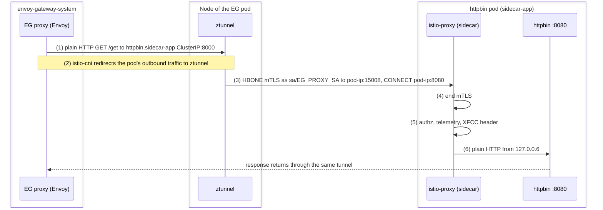

# Envoy Gateway as north-south ingress for Istio (sidecar + ambient)

One Envoy Gateway in front of a mesh that has both sidecar and ambient workloads.
Envoy Gateway does edge work (TLS termination, JWT, rate limiting, WAF); Istio
provides mTLS from the gateway to the backends.

```
Client ──plain HTTP/TLS──► EG proxy pod ──(ztunnel)──► HBONE mTLS ─┬─► sidecar pod (:15008)
                                                                   ├─► waypoint ─► ambient pod
                                                                   └─► ambient pod (no waypoint, L4 only)
```

How it works:

- The EG **proxy pods** are enrolled in ambient with the pod label
  `istio.io/dataplane-mode: ambient` (set through `EnvoyProxy`). The controller
  in the same namespace is not enrolled.
- ztunnel captures the proxy's outbound traffic and wraps it in HBONE mTLS with
  the proxy's ServiceAccount identity.
- Sidecars accept HBONE on port 15008, so sidecar backends work too.
- `routingType: Service` makes Envoy send to the Service ClusterIP, so ztunnel
  sees the Service and sends the traffic through its waypoint. With pod IPs
  (the default) traffic is still mTLS, but skips the waypoint.
- A `PeerAuthentication` keeps the proxy pods PERMISSIVE, so plaintext from
  external clients isn't dropped when the mesh runs STRICT.

## How a request reaches a sidecar app

The EG Envoy never does mTLS itself. It sends plain HTTP, the node's ztunnel
wraps it in an mTLS tunnel, and the app's sidecar unwraps it.



1. **EG sends plain HTTP to the Service IP.** With `routingType: Service`, Envoy
   opens a normal TCP connection to the `httpbin.sidecar-app` ClusterIP on port
   8000. It has no Istio certificates or config.
2. **istio-cni hands the connection to ztunnel.** Because the pod has
   `istio.io/dataplane-mode: ambient`, istio-cni added redirect rules in its
   network namespace when it started. Outbound traffic goes to the node's
   ztunnel, which listens inside the pod's network namespace. Envoy can't tell.
3. **ztunnel opens an mTLS tunnel to the sidecar pod.**
   - It resolves the Service to a pod IP from istiod's workload data, not
     kube-proxy.
   - The sidecar pod is listed as `HBONE` in `istioctl ztunnel-config workloads`,
     meaning istiod told ztunnel it accepts HBONE on port 15008.
   - The Service has no waypoint, so ztunnel connects straight to
     `<pod-ip>:15008` and sends an HTTP/2 `CONNECT <pod-ip>:8080` inside mTLS.
   - It presents the gateway's certificate,
     `spiffe://cluster.local/ns/envoy-gateway-system/sa/<EG_PROXY_SA>`. ztunnel
     can hold that certificate for the pod because istiod trusts it
     (`CA_TRUSTED_NODE_ACCOUNTS=istio-system/ztunnel`).
   - Shows up as `mesh-ingress → httpbin mutual_tls` in ztunnel metrics.
4. **The sidecar ends the mTLS.** Its inbound listener on port 15008 checks the
   peer certificate and opens the tunnel. To the sidecar this looks the same as
   a request from another sidecar.
5. **The sidecar runs its normal inbound checks.**
   - STRICT `PeerAuthentication` passes, because the request arrived over mTLS.
   - `AuthorizationPolicy` matches `source.principal = …/sa/<EG_PROXY_SA>`.
     Callers with any other identity get a 403 here.
   - It records `istio_requests_total{source_principal=…, connection_security_policy="mutual_tls"}`.
   - It adds `X-Forwarded-Client-Cert: By=…/sa/httpbin;URI=…/sa/<EG_PROXY_SA>`.
6. **The sidecar forwards to the app over localhost.** The access log shows
   `inbound|8080||`, sent from `127.0.0.6` to `<pod-ip>:8080`, with the downstream
   address `<EG-pod-ip>:0`. The `:0` is how a connection that arrived through an
   HBONE tunnel appears: the source pod IP is kept, but not the port.

The response comes back through the same tunnel.

What this means:

- **The sidecar app needs no changes.** Sidecars accept HBONE once the mesh has
  ambient installed, so sidecar and ambient backends look the same to EG.
- **The client side of this hop is ztunnel, not a sidecar.** In Istio,
  `DestinationRule` and `VirtualService` settings run in the client's proxy.
  ztunnel only works at L4, so a `DestinationRule`'s load balancing, outlier
  detection and connection-pool settings are **not applied** on this path;
  ztunnel does its own simple endpoint selection. Server-side features in the
  backend's sidecar still apply: authorization, STRICT mTLS, telemetry.
- **Need L7 traffic policy for a sidecar backend?** Put a waypoint in front of
  its Service (`istio.io/use-waypoint` on the namespace or Service). Traffic then
  goes ztunnel → waypoint → sidecar, and the waypoint applies the policy.

An ambient backend works the same way up to step 3. There ztunnel tunnels to the
waypoint instead (because of `istio.io/use-waypoint: waypoint` on `ambient-app`),
and the waypoint tunnels on to the pod's ztunnel.

An ambient backend **without** a waypoint (`ambient-l4-app`) is the simplest
path: ztunnel tunnels straight to `<pod-ip>:15008`, and the destination node's
ztunnel ends the mTLS and hands plain TCP to the app. That ztunnel enforces
`AuthorizationPolicy`, but only at L4: source identity, namespace, IP and port.
Rules on paths, methods or headers can't be enforced without a waypoint. Envoy
Gateway's own L7 features at the edge still apply.

| Backend | Who ends the mTLS | Policy enforced in the mesh |
| --- | --- | --- |
| `sidecar-app` | the pod's sidecar | L4 + L7 (in the sidecar) |
| `ambient-app` | the waypoint, then the pod's ztunnel | L7 on the waypoint, L4 on ztunnel |
| `ambient-l4-app` | the pod's ztunnel | L4 only |

## Files

| File | Contents |
| --- | --- |
| [gateway.yaml](gateway.yaml) | `EnvoyProxy`, `GatewayClass`, `Gateway`, PERMISSIVE `PeerAuthentication` for the proxy |
| [apps.yaml](apps.yaml) | `sidecar-app`, `ambient-app` (with waypoint) and `ambient-l4-app` (no waypoint) httpbin backends and their `HTTPRoute`s |
| [policies.yaml](policies.yaml) | Mesh-wide STRICT mTLS and `AuthorizationPolicy`s that only allow the EG identity |
| [telemetry.yaml](telemetry.yaml) | Mesh-wide Envoy access logs for sidecars and waypoints |

## Run it

```shell
kind create cluster --name eg-mesh

# Istio with ambient (sidecar injection still works in this profile)
istioctl install --set profile=ambient -y

# Envoy Gateway (also installs the Gateway API CRDs)
helm install eg oci://docker.io/envoyproxy/gateway-helm --version v1.10.0 \
  -n envoy-gateway-system --create-namespace
kubectl wait -n envoy-gateway-system deploy/envoy-gateway --for=condition=Available --timeout=5m

kubectl apply -f gateway.yaml
kubectl apply -f apps.yaml
kubectl wait -n envoy-gateway-system gateway/mesh-ingress --for=condition=Programmed --timeout=5m
```

Check that the proxy is in ambient and the controller is not:

```shell
istioctl ztunnel-config workloads | grep envoy-gateway-system
# envoy-envoy-gateway-system-mesh-ingress-<hash>-...  HBONE   <- proxy (default deploy mode)
# envoy-gateway-...                                  TCP     <- controller
```

The proxy's name depends on how EG deploys it:

| EG `provider.kubernetes.deploy.type` | Proxy Deployment / Service / ServiceAccount |
| --- | --- |
| `ControllerNamespace` (default) | `envoy-envoy-gateway-system-mesh-ingress-<hash>` |
| `GatewayNamespace` | `mesh-ingress`, in the Gateway's namespace |

The commands below look things up by the `gateway.envoyproxy.io/owning-gateway-name`
label, so they work in both modes.

## Verify

```shell
kubectl -n envoy-gateway-system port-forward svc/$(kubectl -n envoy-gateway-system get svc \
  -l gateway.envoyproxy.io/owning-gateway-name=mesh-ingress -o jsonpath='{.items[0].metadata.name}') 8080:80 &

curl -s localhost:8080/headers -H 'Host: sidecar.example.com'
curl -s localhost:8080/headers -H 'Host: ambient.example.com'
curl -s localhost:8080/headers -H 'Host: ambient-l4.example.com'
```

The sidecar backend's response includes `X-Forwarded-Client-Cert`, which shows
the request arrived over mTLS from the gateway's identity:

```
By=spiffe://cluster.local/ns/sidecar-app/sa/httpbin;URI=spiffe://cluster.local/ns/envoy-gateway-system/sa/<EG_PROXY_SA>
```

The ambient backends get no such header; ztunnel and the waypoint terminate mTLS
before the app. Use the access logs below to see the identities instead.

### Lock it down

Find the proxy ServiceAccount and put it into the policies:

```shell
EG_PROXY_SA=$(kubectl -n envoy-gateway-system get sa \
  -l gateway.envoyproxy.io/owning-gateway-name=mesh-ingress -o jsonpath='{.items[0].metadata.name}')
sed "s/<EG_PROXY_SA>/${EG_PROXY_SA}/" policies.yaml | kubectl apply -f -
```

Expected results:

```shell
# Through the gateway: allowed
curl -s -o /dev/null -w '%{http_code}\n' localhost:8080/get  -H 'Host: sidecar.example.com'   # 200
curl -s -o /dev/null -w '%{http_code}\n' localhost:8080/get  -H 'Host: ambient.example.com'   # 200
curl -s -o /dev/null -w '%{http_code}\n' localhost:8080/get  -H 'Host: ambient-l4.example.com'   # 200

# Waypoint is on the path: its L7 rule denies /deny
curl -s -o /dev/null -w '%{http_code}\n' localhost:8080/deny -H 'Host: ambient.example.com'   # 403
# No waypoint, so no L7 rule: /deny goes through
curl -s -o /dev/null -w '%{http_code}\n' localhost:8080/deny -H 'Host: ambient-l4.example.com'   # 200

# Gateway still accepts plaintext from outside the mesh even with STRICT mTLS (port-forward above keeps working)

# Any other in-mesh client is rejected
kubectl create ns other && kubectl label ns other istio.io/dataplane-mode=ambient
kubectl -n other run curl --image=curlimages/curl --restart=Never --rm -it -- \
  curl -s -o /dev/null -w '%{http_code}\n' http://httpbin.sidecar-app:8000/get    # 403
kubectl -n other run curl --image=curlimages/curl --restart=Never --rm -it -- \
  curl -s -o /dev/null -w '%{http_code}\n' http://httpbin.ambient-app:8000/get    # 403
# Without a waypoint ztunnel rejects at L4: connection reset, not a 403
kubectl -n other run curl --image=curlimages/curl --restart=Never --rm -it -- \
  curl -s -o /dev/null -w '%{http_code}\n' --max-time 5 http://httpbin.ambient-l4-app:8000/get  # 000 (exit 56)
# ztunnel log on the backend's node: error="connection closed due to policy rejection: allow policies exist, but none allowed"

# Calling the ambient pod IP directly to skip the waypoint is blocked by ztunnel
POD_IP=$(kubectl -n ambient-app get pod -l app=httpbin -o jsonpath='{.items[0].status.podIP}')
kubectl -n other run curl --image=curlimages/curl --restart=Never --rm -it -- \
  curl -s -o /dev/null -w '%{http_code}\n' --max-time 5 http://${POD_IP}:8080/get  # 000, connection reset (exit 56)
```

### Access logs

ztunnel logs every connection by default. Sidecars and waypoints need a
`Telemetry` resource to write Envoy access logs:

```shell
kubectl apply -f telemetry.yaml   # takes ~10s to reach the proxies
```

Send the requests above again, then read each hop:

```shell
# Sidecar backend: request from the EG proxy pod IP
kubectl -n sidecar-app logs deploy/httpbin -c istio-proxy --tail=5
# "GET /get HTTP/1.1" 200 - via_upstream ... "sidecar.example.com" "10.244.x.x:8080" inbound|8080|| ...

# Waypoint: the 403 for /deny is its own RBAC decision
kubectl -n ambient-app logs deploy/waypoint --tail=5
# "GET /get HTTP/1.1" 200 - via_upstream ... inbound-vip|8000|http|httpbin.ambient-app.svc.cluster.local ...
# "GET /deny HTTP/1.1" 403 - rbac_access_denied_matched_policy[none] ...

# ztunnel: gateway identity -> waypoint for the ambient Service
kubectl -n istio-system logs ds/ztunnel --tail=500 | grep 'src.workload="mesh-ingress'
# ... src.identity="spiffe://cluster.local/ns/envoy-gateway-system/sa/<EG_PROXY_SA>"
#     dst.service="httpbin.ambient-app.svc.cluster.local" dst.workload="waypoint-..." ...
```

`kubectl logs ds/ztunnel` reads only one ztunnel pod; check the one on the same
node as the EG proxy pod (`kubectl get pod -o wide`).

## Notes

- **Load balancing moves to the mesh.** With `routingType: Service`, Envoy sees
  one endpoint per Service, so these EG features lose effect: consistent-hash and
  session-affinity load balancing, active health checks, outlier detection, and
  retries that should land on another pod. Configure them on a waypoint, for
  ambient and sidecar backends alike. A `DestinationRule` alone has no effect,
  because the client side of the hop is ztunnel (see
  [How a request reaches a sidecar app](#how-a-request-reaches-a-sidecar-app)).
- **No `BackendTLSPolicy`** for in-mesh backends; the mesh already does mTLS.
- **Gateway namespace mode.** With `deploy.type: GatewayNamespace`, the proxy
  pods live in the Gateway's namespace. Here that is still `envoy-gateway-system`;
  if you move the `Gateway` elsewhere, move the PERMISSIVE `PeerAuthentication`
  with it and change the namespace in the principals in `policies.yaml`.
- **No ambient in your install?** Inject a sidecar into the proxy pods instead
  (`sidecar.istio.io/inject: "true"` label plus
  `traffic.sidecar.istio.io/includeInboundPorts: ""` annotation in
  `EnvoyProxy.spec.provider.kubernetes.envoyDeployment.pod`). It works without
  the PERMISSIVE `PeerAuthentication` but runs two Envoys per pod.

## Cleanup

```shell
kind delete cluster --name eg-mesh
```
